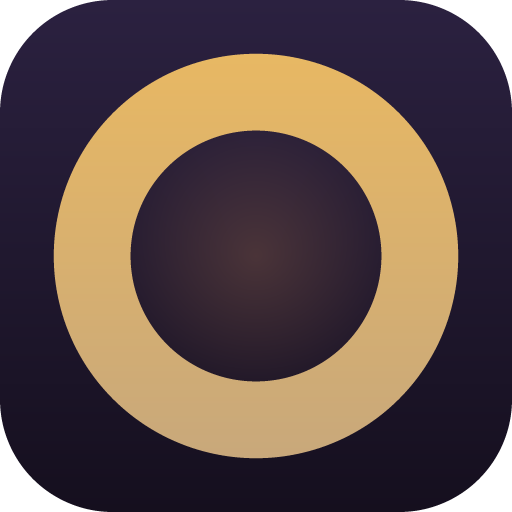

<div align="center">
  
  <h1>Rongyok Desk</h1>
  <p><strong>A dedicated single-site desktop browser for <a href="https://rongyok.com/">rongyok.com</a></strong></p>
  <p><strong>English</strong> · <a href="README.th.md">ภาษาไทย</a></p>

  <p>
    
    
    
    <a href="https://eemeemmeex.github.io/rongyok-desk/"></a>
  </p>

  <p>
    <a href="https://github.com/EEMEEMMEEx/rongyok-desk/releases/download/untagged-64ea1f088167a8283cd3/Rongyok.Desk_1.0.2_x64-setup.exe"></a>
    <a href="https://github.com/EEMEEMMEEx/rongyok-desk/releases/download/untagged-64ea1f088167a8283cd3/Rongyok.Desk_1.0.2_x64_en-US.msi"></a>
    <a href="https://github.com/EEMEEMMEEx/rongyok-desk/releases/download/untagged-64ea1f088167a8283cd3/Rongyok.Desk_1.0.2_aarch64.dmg"></a>
    <a href="https://github.com/EEMEEMMEEx/rongyok-desk/releases/download/untagged-64ea1f088167a8283cd3/Rongyok.Desk_1.0.2_x64.dmg"></a>
    <a href="https://github.com/EEMEEMMEEx/rongyok-desk/releases/download/untagged-64ea1f088167a8283cd3/Rongyok-Desk-1.0.2-x86_64.flatpak"></a>
  </p>
</div>

## Overview

Rongyok Desk is a lightweight desktop app built for anyone who wants **https://rongyok.com/** in its own window instead of a browser tab. It opens straight to the site in a `1280×800` window (minimum `520×400`) and keeps your session signed in between launches. External links open in your default web browser, so this window stays focused on Rongyok.

---

## Download (`v1.0.2`)

| Platform | Chip | Size | Installer |
| --- | --- | --- | --- |
| Windows (recommended) | `x64` | 1.19 MB | [Rongyok.Desk_1.0.2_x64-setup.exe](https://github.com/EEMEEMMEEx/rongyok-desk/releases/download/untagged-64ea1f088167a8283cd3/Rongyok.Desk_1.0.2_x64-setup.exe) |
| Windows (MSI) | `x64` | 1.70 MB | [Rongyok.Desk_1.0.2_x64_en-US.msi](https://github.com/EEMEEMMEEx/rongyok-desk/releases/download/untagged-64ea1f088167a8283cd3/Rongyok.Desk_1.0.2_x64_en-US.msi) |
| macOS (Apple Silicon) | `arm64` | 1.74 MB | [Rongyok.Desk_1.0.2_aarch64.dmg](https://github.com/EEMEEMMEEx/rongyok-desk/releases/download/untagged-64ea1f088167a8283cd3/Rongyok.Desk_1.0.2_aarch64.dmg) |
| macOS (Intel) | `x64` | 1.83 MB | [Rongyok.Desk_1.0.2_x64.dmg](https://github.com/EEMEEMMEEx/rongyok-desk/releases/download/untagged-64ea1f088167a8283cd3/Rongyok.Desk_1.0.2_x64.dmg) |
| Linux (Flatpak) | `x86_64` | 1.10 MB | [Rongyok-Desk-1.0.2-x86_64.flatpak](https://github.com/EEMEEMMEEx/rongyok-desk/releases/download/untagged-64ea1f088167a8283cd3/Rongyok-Desk-1.0.2-x86_64.flatpak) |

<p align="center">
  
</p>

---

## Installation

> **Note:** The `v1.0.2` installers are unsigned, so Windows SmartScreen or macOS Gatekeeper will ask you to confirm on first launch.

### Windows
1. Download [Rongyok.Desk_1.0.2_x64-setup.exe](https://github.com/EEMEEMMEEx/rongyok-desk/releases/download/untagged-64ea1f088167a8283cd3/Rongyok.Desk_1.0.2_x64-setup.exe) (installs for your user account and fetches Microsoft Edge WebView2 Runtime if needed) or [Rongyok.Desk_1.0.2_x64_en-US.msi](https://github.com/EEMEEMMEEx/rongyok-desk/releases/download/untagged-64ea1f088167a8283cd3/Rongyok.Desk_1.0.2_x64_en-US.msi).
2. Run the installer.
3. If **Windows SmartScreen** warns you, click **More info** then **Run anyway**.

### macOS (`10.15+`)
1. Download [Rongyok.Desk_1.0.2_aarch64.dmg](https://github.com/EEMEEMMEEx/rongyok-desk/releases/download/untagged-64ea1f088167a8283cd3/Rongyok.Desk_1.0.2_aarch64.dmg) (Apple Silicon) or [Rongyok.Desk_1.0.2_x64.dmg](https://github.com/EEMEEMMEEx/rongyok-desk/releases/download/untagged-64ea1f088167a8283cd3/Rongyok.Desk_1.0.2_x64.dmg) (Intel).
2. Open the `.dmg` and drag **Rongyok Desk.app** into **Applications**.
3. On first launch, **Control-click (right-click)** the app, then choose **Open** → **Open** (or allow it in **System Settings → Privacy & Security → Open Anyway**).

### Linux (`x86_64`)
1. Download [Rongyok-Desk-1.0.2-x86_64.flatpak](https://github.com/EEMEEMMEEx/rongyok-desk/releases/download/untagged-64ea1f088167a8283cd3/Rongyok-Desk-1.0.2-x86_64.flatpak).
2. Install and run the Flatpak bundle (`com.rongyok.ssb`):

```bash
flatpak remote-add --user --if-not-exists flathub https://flathub.org/repo/flathub.flatpakrepo
flatpak install --user Rongyok-Desk-1.0.2-x86_64.flatpak
flatpak run com.rongyok.ssb
```

---

## Features

- **Focused single-site window** — Opens `https://rongyok.com/` at `1280×800` and keeps your cookies and login across restarts.
- **Strict domain lock** — Loads only `rongyok.com` and its subdomains inside the app window.
- **External link handoff** — Sends links to other websites, lookalike domains, and email or file links to your default browser.
- **Remembered window placement** — Reopens at your last size and position, or centers on the main screen if a monitor was unplugged.
- **Smooth media and fullscreen** — Plays video and audio automatically and expands videos to fill the window.
- **Reliable shortcuts and clean release** — Keeps navigation keys working over page scripts and disables DevTools (the browser inspector) in release builds.

<details>
<summary>Technical details</summary>

- **Persistent session storage:** Cookies, cache, and `localStorage` live on disk at `<app_local_data_dir>/webview` (`~/.var/app/com.rongyok.ssb` on Flatpak).
- **Navigation and pop-up rules:** `on_navigation` and `on_new_window` (`target="_blank"`) allow only `http://` and `https://` URLs on `rongyok.com` or `*.rongyok.com`, plus internal `about:`, `data:`, and `blob:` webview URLs.
- **External browser dispatch:** Blocked domains, lookalike hosts, and external schemes (`mailto:`, `tel:`, `file:`) launch via `ShellExecuteW` on Windows, `open` on macOS, or `xdg-open` on Linux.
- **Window placement persistence:** Saves `x y width height maximized` to `window-placement.txt` on close/destroy, checks bounds (`520..20000 × 400..20000`), and verifies `available_monitors()` at startup.
- **Media and Flatpak permissions:** Uses `--autoplay-policy=no-user-gesture-required` with background throttling disabled, syncs Windows WebView2 `ContainsFullScreenElementChanged` to native fullscreen, and enables `--socket=pulseaudio` and `--device=dri` in Flatpak.
- **Shortcuts and DevTools:** Capture-phase JS listeners protect navigation keys alongside the native **Navigate** menu; DevTools are gated behind `cfg!(debug_assertions)`.

</details>

---

## Keyboard Shortcuts

| Action | Shortcut | Notes |
| --- | --- | --- |
| Back | `Alt+Left` | Also in **Navigate** menu |
| Forward | `Alt+Right` | Also in **Navigate** menu |
| Reload | `F5` / `Ctrl+R` / `Cmd+R` | Reloads page |
| Go to `rongyok.com` | `Ctrl+H` | Opens `https://rongyok.com/` (`START_URL`) |
| Full screen | `F11` | Toggles fullscreen |
| Open this page in browser | Menu only | Opens current page in system browser |
| Quit | `Ctrl+Q` | Closes app |
