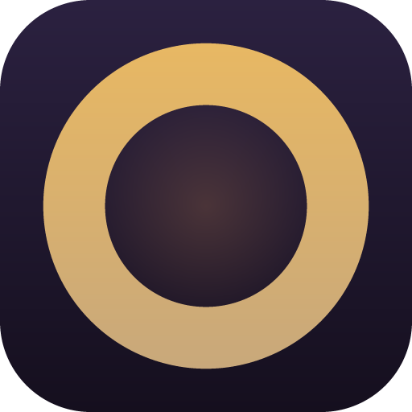

<div align="center">
  
  <h1>Rongyok Desk</h1>
  <p><strong>แอปเดสก์ท็อปเฉพาะทางสำหรับเปิด <a href="https://rongyok.com/">rongyok.com</a></strong></p>
  <p><a href="README.md">English</a> · <strong>ภาษาไทย</strong></p>

  <p>
    
    
    
    <a href="https://eemeemmeex.github.io/rongyok-desk/"></a>
  </p>

  <p>
    <a href="https://github.com/EEMEEMMEEx/rongyok-desk/releases/latest/download/Rongyok.Desk_1.1.0_x64-setup.exe"></a>
    <a href="https://github.com/EEMEEMMEEx/rongyok-desk/releases/latest/download/Rongyok.Desk_1.1.0_x64_en-US.msi"></a>
    <a href="https://github.com/EEMEEMMEEx/rongyok-desk/releases/latest/download/Rongyok.Desk_1.1.0_aarch64.dmg"></a>
    <a href="https://github.com/EEMEEMMEEx/rongyok-desk/releases/latest/download/Rongyok.Desk_1.1.0_x64.dmg"></a>
    <a href="https://github.com/EEMEEMMEEx/rongyok-desk/releases/latest/download/Rongyok-Desk-1.1.0-x86_64.flatpak"></a>
  </p>
</div>

## ภาพรวม

Rongyok Desk เป็นแอปเดสก์ท็อปขนาดเบาสำหรับผู้ที่ต้องการใช้งาน **https://rongyok.com/** ในหน้าต่างเฉพาะของตัวเองแทนการเปิดแท็บบนเบราว์เซอร์ แอปจะเปิดเข้าเว็บไซต์โดยตรงในหน้าต่างขนาด `1280×800` (ขั้นต่ำ `520×400`) พร้อมจำสถานะการเข้าสู่ระบบข้ามการเปิดปิด และส่งลิงก์ไปยังเว็บอื่นให้เปิดในเบราว์เซอร์ปกติของคุณแทน

---

## ดาวน์โหลด (`v1.1.0`)

| แพลตฟอร์ม | สถาปัตยกรรม | ขนาด | ตัวติดตั้ง |
| --- | --- | --- | --- |
| Windows (แนะนำ) | `x64` | 1.19 MB | [Rongyok.Desk_1.1.0_x64-setup.exe](https://github.com/EEMEEMMEEx/rongyok-desk/releases/latest/download/Rongyok.Desk_1.1.0_x64-setup.exe) |
| Windows (MSI) | `x64` | 1.71 MB | [Rongyok.Desk_1.1.0_x64_en-US.msi](https://github.com/EEMEEMMEEx/rongyok-desk/releases/latest/download/Rongyok.Desk_1.1.0_x64_en-US.msi) |
| macOS (Apple Silicon) | `arm64` | 1.75 MB | [Rongyok.Desk_1.1.0_aarch64.dmg](https://github.com/EEMEEMMEEx/rongyok-desk/releases/latest/download/Rongyok.Desk_1.1.0_aarch64.dmg) |
| macOS (Intel) | `x64` | 1.84 MB | [Rongyok.Desk_1.1.0_x64.dmg](https://github.com/EEMEEMMEEx/rongyok-desk/releases/latest/download/Rongyok.Desk_1.1.0_x64.dmg) |
| Linux (Flatpak) | `x86_64` | 1.11 MB | [Rongyok-Desk-1.1.0-x86_64.flatpak](https://github.com/EEMEEMMEEx/rongyok-desk/releases/latest/download/Rongyok-Desk-1.1.0-x86_64.flatpak) |

<p align="center">
  
</p>

---

## วิธีติดตั้ง

> **หมายเหตุ:** ตัวติดตั้ง `v1.1.0` ยังไม่ได้ลงนามดิจิทัล (unsigned) ดังนั้น Windows SmartScreen หรือ macOS Gatekeeper จะแสดงคำเตือนให้กดยืนยันเมื่อเปิดใช้งานครั้งแรก

### Windows
1. ดาวน์โหลด [Rongyok.Desk_1.1.0_x64-setup.exe](https://github.com/EEMEEMMEEx/rongyok-desk/releases/latest/download/Rongyok.Desk_1.1.0_x64-setup.exe) (ติดตั้งเฉพาะผู้ใช้ปัจจุบัน และดาวน์โหลด Microsoft Edge WebView2 Runtime ให้อัตโนมัติหากยังไม่มี) หรือ [Rongyok.Desk_1.1.0_x64_en-US.msi](https://github.com/EEMEEMMEEx/rongyok-desk/releases/latest/download/Rongyok.Desk_1.1.0_x64_en-US.msi)
2. เปิดรันตัวติดตั้ง
3. หาก **Windows SmartScreen** แจ้งเตือน ให้กด **More info** แล้วเลือก **Run anyway**

### macOS (`10.15+`)
1. ดาวน์โหลด [Rongyok.Desk_1.1.0_aarch64.dmg](https://github.com/EEMEEMMEEx/rongyok-desk/releases/latest/download/Rongyok.Desk_1.1.0_aarch64.dmg) (Apple Silicon) หรือ [Rongyok.Desk_1.1.0_x64.dmg](https://github.com/EEMEEMMEEx/rongyok-desk/releases/latest/download/Rongyok.Desk_1.1.0_x64.dmg) (Intel)
2. เปิดไฟล์ `.dmg` แล้วลาก **Rongyok Desk.app** ไปวางใน **Applications**
3. เมื่อเปิดใช้งานครั้งแรก ให้ **กด Control ค้างแล้วคลิก (หรือคลิกขวา)** ที่แอป เลือก **Open** → **Open** (หรือไปกดอนุญาตที่ **System Settings → Privacy & Security → Open Anyway**)

### Linux (`x86_64`)
1. ดาวน์โหลด [Rongyok-Desk-1.1.0-x86_64.flatpak](https://github.com/EEMEEMMEEx/rongyok-desk/releases/latest/download/Rongyok-Desk-1.1.0-x86_64.flatpak)
2. ติดตั้งและเปิดใช้งานแพ็กเกจ Flatpak (`com.rongyok.ssb`):

```bash
flatpak remote-add --user --if-not-exists flathub https://flathub.org/repo/flathub.flatpakrepo
flatpak install --user Rongyok-Desk-1.1.0-x86_64.flatpak
flatpak run com.rongyok.ssb
```

---

## ฟีเจอร์หลัก

- **หน้าต่างเฉพาะเว็บเดียว** — เปิด `https://rongyok.com/` ขนาด `1280×800` พร้อมเก็บคุกกี้และสถานะล็อกอินข้ามการเปิดปิดแอป
- **ล็อกโดเมนอย่างเข้มงวด** — อนุญาตให้โหลดเฉพาะ `rongyok.com` และ subdomain ภายใต้โดเมนนี้เท่านั้น
- **ส่งลิงก์นอกออกเบราว์เซอร์** — ลิงก์ไปยังเว็บอื่น โดเมนปลอม หรือลิงก์อีเมล/ไฟล์จะถูกส่งไปเปิดในเบราว์เซอร์หลักของคุณ
- **จำขนาดและตำแหน่งหน้าต่าง** — เปิดกลับมาตรงตำแหน่งและขนาดเดิม หรือจัดกึ่งกลางจอหลักอัตโนมัติหากถอดจอนอกออก
- **เล่นสื่อและเต็มจอลื่นไหล** — เล่นวิดีโอและเสียงอัตโนมัติ พร้อมขยายเต็มหน้าต่างเมื่อวิดีโอขอโหมดเต็มจอ
- **คีย์ลัดทำงานเสถียรและปิดตัวตรวจสอบหน้าเว็บ** — คีย์นำทางทำงานแม้สคริปต์หน้าเว็บพยายามดัก และปิด DevTools ในรุ่นเผยแพร่

<details>
<summary>Technical details (รายละเอียดทางเทคนิค)</summary>

- **การจัดเก็บข้อมูลเซสชัน:** คุกกี้ แคช และ `localStorage` เก็บไว้ที่ `<app_local_data_dir>/webview` (บน Flatpak อยู่ที่ `~/.var/app/com.rongyok.ssb`)
- **กฎการนำทางและป๊อปอัป:** `on_navigation` และ `on_new_window` (`target="_blank"`) อนุญาตเฉพาะ `http://` และ `https://` ของ `rongyok.com` หรือ `*.rongyok.com` รวมถึง URL ภายใน webview (`about:`, `data:`, `blob:`)
- **การเปิดลิงก์ภายนอก:** โดเมนอื่น โดเมนเลียนแบบ และ scheme ภายนอก (`mailto:`, `tel:`, `file:`) จะถูกเรียกเปิดผ่าน `ShellExecuteW` บน Windows, `open` บน macOS หรือ `xdg-open` บน Linux
- **การจำตำแหน่งหน้าต่าง:** บันทึก `x y width height maximized` ลงไฟล์ `window-placement.txt` เมื่อปิดหน้าต่าง ตรวจสอบขอบเขตที่ใช้ได้ (`520..20000 × 400..20000`) และเช็ก `available_monitors()` ตอนเปิดแอป
- **สื่อและสิทธิ์ของ Flatpak:** ใช้ `--autoplay-policy=no-user-gesture-required` พร้อมปิด background throttling, เชื่อม `ContainsFullScreenElementChanged` บน Windows WebView2 เข้ากับโหมดเต็มจอ และเปิด `--socket=pulseaudio` กับ `--device=dri` ใน Flatpak
- **คีย์ลัดและ DevTools:** ใช้ JS listener แบบ capture-phase ทำงานร่วมกับเมนู **Navigate** และเปิดใช้ DevTools เฉพาะโหมด debug (`cfg!(debug_assertions)`)

</details>

---

## คีย์ลัดและเมนู

| คำสั่ง | คีย์ลัด | หมายเหตุ |
| --- | --- | --- |
| Back (ย้อนกลับ) | `Alt+Left` | มีในเมนู **Navigate** ด้วย |
| Forward (ไปข้างหน้า) | `Alt+Right` | มีในเมนู **Navigate** ด้วย |
| Reload (โหลดใหม่) | `F5` / `Ctrl+R` / `Cmd+R` | รีโหลดหน้าปัจจุบัน |
| Go to `rongyok.com` | `Ctrl+H` | กลับหน้าหลัก `https://rongyok.com/` (`START_URL`) |
| Full screen (เต็มจอ) | `F11` | สลับโหมดเต็มจอ |
| Open this page in browser | เมนูเท่านั้น | เปิดหน้าปัจจุบันในเบราว์เซอร์หลัก |
| Quit (ออกจากแอป) | `Ctrl+Q` | ปิดแอป |
